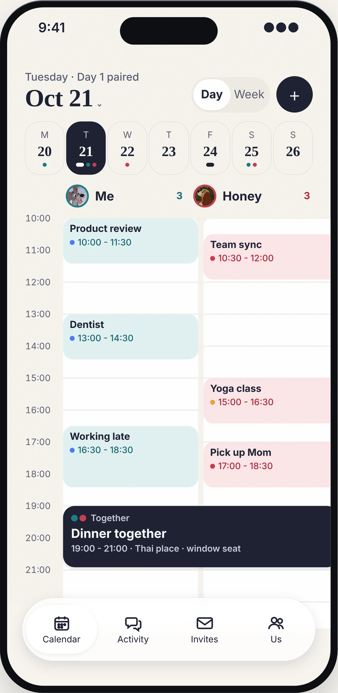
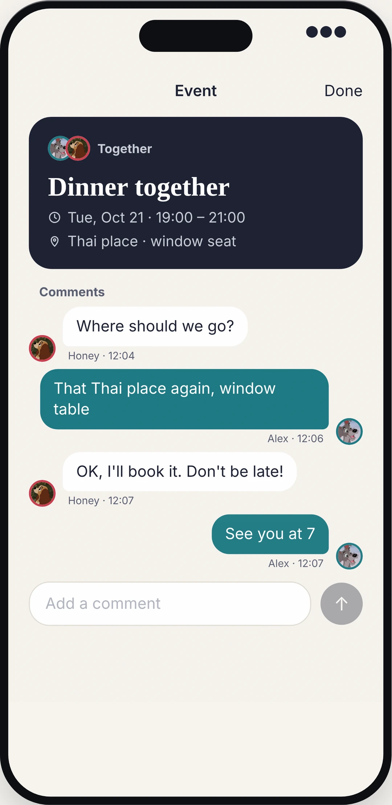
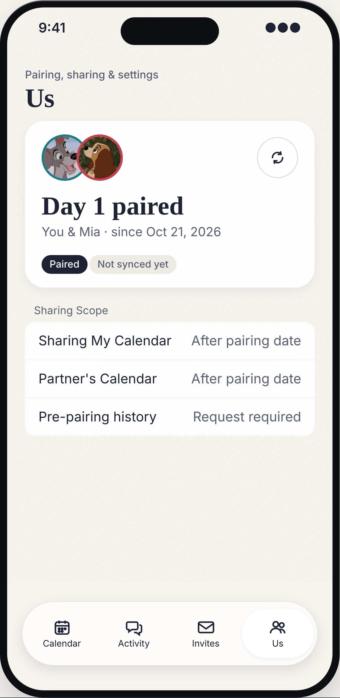
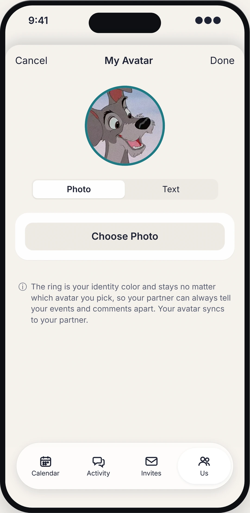
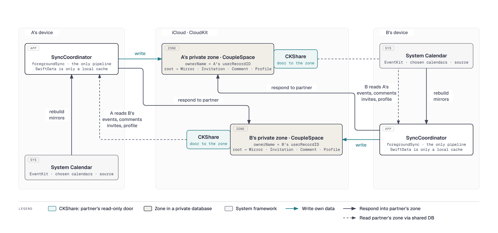
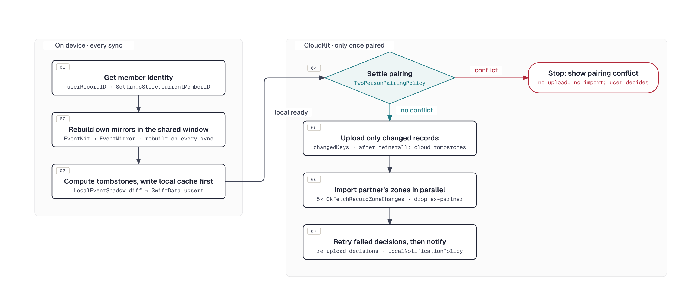

# OurDays

[简体中文](README.md) | **English**

OurDays (formerly ShareCal) is a shared calendar iOS app for couples, **strictly paired between two people**: each partner picks which system calendars to share, and the app mirrors those events into iCloud, where a CKShare makes them visible to the other person. No account passwords are uploaded and there is no self-hosted server: all data lives only in the two people's own iCloud accounts.

[](https://apps.apple.com/app/id6772868166)
[](https://ourdays.cn)
[](LICENSE)
[](https://github.com/BeenLi/OurDays/actions/workflows/ios-ci.yml)

**Fully open source, free forever, no servers.** Data stays in each user's own iCloud. The project's only fixed cost is the yearly Apple Developer Program fee, so it doesn't need subscriptions or ads to keep going.

## Features

- **Two-person pairing**: pair through an iCloud share link; each side creates its own CKShare. If a third person later joins through an old link, or a stranger shares with you, the app never silently kicks anyone out. It shows a "Pairing conflict / Replace partner" prompt and lets you choose; leftover old shared zones are left automatically. **Unpairing** deletes my CKShare and removes the ex-partner's comments, invitations and history requests from my zone, so nothing carries over into the next pairing.
- **Event sync**: mirrors events from the selected system calendars (EventKit), with four visibility levels per event (full details / title + location / busy only / hidden). Local adds, edits and deletes converge on every sync (deletes travel to the partner as tombstones); in the background, iCloud silent pushes plus background refresh catch up on a best-effort basis.
- **Event invitations**: invite your partner to an event; once accepted it is written into their system calendar. Status (pending / accepted / declined / cancelled) syncs both ways. Invitations can only be sent for events that **haven't ended**; an invitation still unanswered when the event ends shows as "Expired" on both sides, and the sender can **withdraw** a pending invitation at any time.
- **Comments and activity**: comment on either person's events, with edit, delete and read state; you can **start a thread on your own event before it has synced**, and your partner picks it up once it arrives. The Activity tab groups both people's comments by event, bubbles carry each person's avatar, and the unread count shows on the tab badge.
- **Notifications**: local notifications when your partner comments on your event, when you receive an invitation or yours gets a reply, and for history requests and their replies (only these four kinds; plain calendar changes stay quiet).
- **History requests**: by default only events after the pairing day are shared; to see earlier history you send a request, and once your partner approves, a time window opens up.
- **Nicknames and avatars**: your partner is shown as "your note > their synced nickname > fallback". Avatars can be a photo or text on a color and sync through iCloud; iCloud identity details such as email are never shown. The Us tab shows "Day N together".
- **Survives reinstall**: pairing, comments and invitations all live in your own iCloud. On first launch after reinstalling, if existing data is found, choose "Keep using existing iCloud data" to restore the pairing day, nickname and avatar without pairing again; events deleted while the app was gone get tombstones too, so nothing lingers on your partner's side.
- **Chinese and English**: built-in Chinese and English strings, switchable in settings.

## Product UI

The app uses a standard four-tab iOS layout:

| Tab | Contents |
| --- | --- |
| **Calendar** | Day / week views with a two-column "me" and "partner" timeline; overlapping events sit side by side, and accepted invitations span both columns as joint events. Tap an event for details and comments |
| **Activity** | A cross-event comment feed grouped by event, newest first; the unread count (new comments from your partner) shows on the tab badge |
| **Invites** | A to-do list of received invitations and history requests (the tab badge shows how many are open); handled and expired ones sink to the bottom |
| **Us** | Pairing status card (pair / unpair / sync / request history / Day N together), nickname, note and avatar, shared calendar selection, default visibility, language, deleting iCloud data |

| Two-column day view | Event details and comments | Us: Day N together | Nickname and avatar |
| --- | --- | --- | --- |
|  |  |  |  |

## Tech stack

| Layer | Technology |
| --- | --- |
| UI | SwiftUI (`@Observable`), no third-party dependencies |
| Local storage | SwiftData (local cache only, `cloudKitDatabase: .none`) + UserDefaults (settings and pairing state) |
| Cloud sync | Native CloudKit APIs (`CKModifyRecordsOperation` to write, `CKFetchRecordZoneChangesOperation` to read): an own `CoupleSpace` zone in the private database + hierarchical CKShare; two `CKDatabaseSubscription` silent pushes with `BGAppRefresh` as fallback. **No CKSyncEngine, no SwiftData CloudKit auto-sync** |
| System calendar | EventKit (reads the selected calendars, creates events for accepted invitations) |
| Identity | CloudKit `userRecordID` is the only member ID (it is the shared zone's ownerName; no custom account system) |
| Tests | XCTest unit tests (about 300 cases; decision logic lives in stateless "Policy enums" tested directly) + a few XCUITests + a two-simulator pairing smoke script |
| Minimum OS | iOS 18.0 |

## Sync architecture

Each person owns a private `CoupleSpace` zone. Every record hangs under the `couple-space-root` root record, and one CKShare shares the whole zone with the partner, who reads it through the shared database (sharedCloudDatabase). **The zone's ownerName is the authoritative identity for who owns the data.**



- **Write path rule**: your own data goes into your private zone; responses to your partner's data (comments, invitation status, request approvals) go into your partner's shared zone.
- **Mirrors are derived data**: your own EventMirrors are rebuilt from EventKit on every sync; SwiftData is just a cache.
- **mirrorKey is the stable cross-device anchor**: `calendarID:eventID:occurrenceDate` is at once the SwiftData id, the CloudKit recordName and the comment thread key. Both sides generate it the same way, which is why an event can be commented on before it has synced.

### Record types

CloudKit holds only 6 record types (schema in [`CloudKit/ShareCalSchema.ckdb`](CloudKit/ShareCalSchema.ckdb)). All of them have `couple-space-root` as parent, so a single CKShare covers the whole zone:

| Record | Purpose | Who writes, and where |
| --- | --- | --- |
| `CoupleSpace` | Root record `couple-space-root`; stores only `ownerMemberID`, and the CKShare hangs on it | Each side writes its own zone |
| `EventMirror` | Mirror of a system calendar event, recordName = `mirrorKey` (`calendarID:eventID:occurrenceDate`), with visibility and a `deletedAt` tombstone | Each side writes its own zone; the partner reads only |
| `MemberProfile` | Nickname + avatar (image bytes / text / color) | Each side writes its own zone |
| `EventInvitation` | Event invitations and their status; history requests reuse this type with a `history-access-request:` prefix (to avoid deploying another record type) | The sender writes its own zone; the responder writes the status back into the sender's shared zone |
| `EventComment` | Comments; `eventMirrorID` points to the commented mirrorKey (joint events point to the invitation id) | Comments on your own events go into your zone; comments on your partner's events go into their shared zone |
| `CalendarAccessRequest` | Local model for history requests; travels in the cloud as the prefixed Invitation records above | Same as invitations |

Local SwiftData also has `LocalEventShadow`, which never goes to the cloud: it records each local event's fingerprint and `lastUploadedAt` from its last successful upload, and is the basis for "upload only changed mirrors" and "detect local deletes".

### Data safety

**Where is the data?** In exactly two places: the `CoupleSpace` zone in your own iCloud private database (every record in the table above), and the SwiftData cache + UserDefaults settings on your phone. No server ever touches it, and the developer cannot see anyone's data. Your system calendars are never modified; the app only reads the selected calendars, and its only write is creating events for invitations you accept. All your partner can see is the one zone your CKShare shares with them, read-only.

**Is the data still there after an app update?** Yes. Updates don't touch iCloud, the local cache goes through a SwiftData lightweight migration, and pairing state is kept in UserDefaults; even if the cache is corrupted, the next sync rebuilds it from EventKit and your partner's zone. The CloudKit schema is deployed to Production before each release, and new fields are simply invisible to older versions rather than breaking them.

**What happens to the data when you unpair?** Unpair on the Us tab does three things in order: deletes my CKShare (the partner immediately loses read access to my zone); deletes from my private zone every comment **not written by me** plus **all** invitations and history requests (in a two-person space these always involve the ex-partner; comments I wrote on my own events stay); and clears the partner's mirrors, comments, invitations and pairing state from the local cache. The partner's own share is left alone for them to unpair. The zone records have to go because the next CKShare shares the whole zone as-is with the next person; even if this step fails (for example offline), `PartnerScopedDataPolicy` still blocks, during import, any record whose other party is neither me nor the current partner. Choosing "replace with the newcomer" in a pairing conflict takes the same cleanup path.

**What happens to the data when you delete the app?** The cache and settings on the phone go with the app, while the zone and share in iCloud, and your partner's share, all remain. On first launch after reinstalling, the app detects existing data under this Apple ID and asks you to choose "Keep using existing iCloud data" or "Delete", and doesn't sync until you decide. Keep restores the pairing day from the root record's creation date and the nickname and avatar from your own `MemberProfile`, with no re-pairing needed; the first sync diffs against your own mirrors in the cloud and adds tombstones for events deleted from the system calendar while the app was gone, so your partner doesn't keep seeing ghost events (`OwnMirrorReconciliationPolicy`). A real full wipe is "Delete my iCloud data": it deletes my share and my whole private zone, leaves the partner's share and clears local data, leaving system calendars untouched.

### What one sync does

The app has a single sync pipeline, `SyncCoordinator.foregroundSync`. Foreground and background triggers run the same code, serially on the main actor. The order is deliberate: everything the device can compute locally comes first, and **pairing is settled before touching the cloud**. When there is a conflict, not a single byte is uploaded or imported, so new data never leaks to someone about to be rejected.



A few details worth knowing:

- The "deletes" in step 03 come from `LocalEventShadow`: it remembers each local event's fingerprint from its last successful upload; events that disappeared become tombstones with `deletedAt`, and events that left the shared time window are hard-deleted.
- Step 05 uploads only mirrors the shadow marks as changed; the root record and `MemberProfile` are saved only when a field really changed. Any CloudKit `save` triggers the partner's subscription push even with no field changes, so "save every time" would make the two phones wake each other up and drain the silent push budget.
- Step 06 sends five requests at once, each a `CKFetchRecordZoneChangesOperation` with a nil change token (full fetch per zone, client-side filtering by record type, only `desiredKeys`); on import, `ownerMemberID` is always overwritten with the zone's ownerName.
- Step 07: accept / decline / approve in the tabs are optimistic, one-shot uploads, and failed decisions are retried here; then local notifications go out only for the four event kinds (partner comments on my event, invitation received, invitation answered, history request and reply).

### When sync runs

- **Opening the app, switching tabs, finishing an edit**: the UI calls `SyncCoordinator.syncIfIdle`; automatic syncs are at least 60 s apart, while pull-to-refresh or tapping Sync is not throttled.
- **Your partner wrote data**: one `CKDatabaseSubscription` each on the private and shared databases sends a content-available silent push, and `ShareCalBackgroundSyncRunner.runSync` immediately runs the full pipeline, bypassing the 60 s throttle.
- **The system dropped the push**: `BGAppRefreshTask` is the fallback, scheduling the next run each time; iOS's minimum interval is about 15 min.

Pushes are silent rather than visible notifications because database subscriptions fire on any record change in the zone and can't filter by type; `LocalNotificationPolicy`, after sync completes, decides which changes are worth interrupting the user for.

## Development

```bash
# Build
xcodebuild -project OurDays.xcodeproj -scheme OurDays \
  -destination 'platform=iOS Simulator,name=iPhone 17 Pro' build

# Unit tests
xcodebuild -project OurDays.xcodeproj -scheme OurDaysTests \
  -destination 'platform=iOS Simulator,name=iPhone 17 Pro' test

# Import the CloudKit schema into Development (deploy Production in the CloudKit Console)
Scripts/import-cloudkit-schema.sh development

# Two-simulator pairing smoke test (needs two fixed simulators signed in to iCloud, see docs/development.md)
Scripts/dev-pairing-smoke.sh
```

The Debug configuration carries the `LOCAL_SIGNING` compilation condition, which turns CloudKit off entirely (`AppServices.isCloudKitEnabled == false`), so the UI runs locally without a developer account; the smoke script builds with overridden entitlements to reach the Development environment. Release uses Production.

### Code structure

`OurDays/` has no third-party dependencies and is split into layer directories with a fixed dependency direction, **Views → Services → Policies → Models**; Policies never reference services or storage (zero file-level reverse dependencies since the 2026-10 refactor):

```text
OurDays/
├── OurDays/                       Layer directories; dependencies only point down: App → Views → Services → Policies → Models
│   ├── App/                       Entry point and process-level objects
│   │   ├── OurDaysApp.swift               @main, AppDelegate: BGTask registration, silent push entry, notification permission
│   │   ├── ShareCalSceneDelegate.swift    Scene delegate, CKShare acceptance, replace-partner confirmation
│   │   ├── AppServices.swift              Service container
│   │   └── Info.plist, *.entitlements     Debug / Local / Production entitlements
│   ├── Models/
│   │   └── Models.swift                   SwiftData models (EventMirror, LocalEventShadow, EventInvitation, EventComment, CalendarAccessRequest, MemberProfile) and local cleanup
│   ├── Policies/                  "Policy" = decides, never acts: stateless enums with pure static functions, values in, "what to do" out, no I/O; services carry out the answer
│   │   ├── PairingPolicies.swift          TwoPersonPairingPolicy, ShareAcceptanceGuardPolicy, ExistingICloudDataRecoveryPolicy (reinstall recovery), PartnerScopedDataPolicy (ex-partner filtering)
│   │   ├── SyncPolicies.swift             ForegroundSyncPolicy (throttling), CloudKitMirrorSyncPolicy (which mirrors to upload), OwnMirrorReconciliationPolicy (reinstall tombstones), BackgroundRefreshSchedulePolicy
│   │   ├── CloudKitPolicies.swift         Write destination, share hierarchy, root record metadata, import filtering, stop sharing, ex-partner cleanup on unpair
│   │   ├── InvitationAndAccessRequestPolicies.swift  Invitation expiry / withdraw / merge / retry, history requests, pairing day, shared time window
│   │   ├── CommentPolicies.swift          Comment thread anchors (mirrorKey / invitation id), whether details can be commented, unread dots
│   │   ├── ActivityAndNotificationPolicies.swift     Activity feed grouping, LocalNotificationPolicy (four notification kinds)
│   │   ├── CalendarSourcePolicies.swift   EventKit authorization state, EventMirrorKeyPolicy, calendar selection
│   │   ├── CalendarDisplayPolicies.swift  Time strings, DateFormatterCache, CalendarDisplayMirrorPolicy (instant display of own events)
│   │   ├── CalendarNavigationPolicies.swift / DayTimelinePolicies.swift / AgendaPolicies.swift  Date navigation, two-column layout, joint events, week agenda
│   │   └── MemberIdentityPolicies.swift   MemberIDPolicy normalization, avatars and display names
│   ├── Services/                  The layer that acts: I/O, persistence, sync pipeline; every decision is asked of Policies
│   │   ├── SyncCoordinator.swift          foregroundSync: the only sync pipeline; ShareCalBackgroundSyncRunner (push / BGAppRefresh entry); notification scheduling
│   │   ├── CloudKitCoupleSpaceService.swift   All CloudKit I/O: zone / root / share / subscriptions / queries / writes
│   │   ├── CloudKitRecordMappers.swift    Pure CKRecord ↔ model mapping (writes changed fields only), batch upsert and query strategy
│   │   ├── CalendarAccessService.swift    EventKit access
│   │   ├── EventServices.swift            EventMirrorService / InvitationService / CommentService: creation and mutation, no decisions
│   │   └── SettingsStore.swift            Settings and pairing state persisted in UserDefaults (@Observable)
│   ├── Views/                     SwiftUI screens, one screen per file (App target only)
│   │   ├── RootView.swift                 Four-tab container, sheet/alert routing, pairing conflict and existing iCloud data prompts
│   │   ├── CalendarTabView.swift          Calendar tab: day/week switch, two-column timeline container
│   │   ├── DayTimeline/                   Aligned two-column day view: Lane (one column), Chrome (time axis / now line)
│   │   ├── WeekAgendaView.swift           Week agenda
│   │   ├── EventDetail/                   Event details + comments
│   │   ├── ActivityTabView.swift          Activity tab
│   │   ├── InvitesTabView.swift           Invites tab (invitations + history requests)
│   │   ├── CreateInviteView.swift         Create an invitation
│   │   ├── Settings/                      Us tab: SettingsTabView, PairingStatusCard, AvatarEditorSheet, HistoryRequestSheet
│   │   ├── OnboardingSheets.swift         First-launch onboarding, pairing safety notes
│   │   ├── HierarchicalDatePickerSheet.swift  Year/month/day date picker
│   │   ├── DesignSystem.swift             OurDaysTheme, card/button styles, avatar views
│   │   └── CloudSharingController.swift   UICloudSharingController wrapper
│   ├── Diagnostics/               Probes and smoke tools driven only by launch arguments, unused in normal runs
│   └── Resources/
│       ├── Assets.xcassets                Icons, colors
│       └── ShareCalStrings.swift          Hand-written Chinese and English strings
├── OurDaysTests/                  XCTest, one file per domain, compiles non-UI sources directly (no @testable import)
│                                  PairingTests / CloudKitTests / SyncTests / CalendarMirrorTests /
│                                  InvitationAndAccessRequestTests / CommentTests /
│                                  DayTimelineAndNavigationTests / ActivityAndNotificationTests / SettingsAndStringsTests
├── OurDaysUITests/                XCUITest: launch, swipe between days, onboarding, and (on paired simulators) partner events and comment threads
├── OurDays.xcodeproj              Schemes OurDays (everything) and OurDaysTests (unit tests only); App, unit test and UI test targets
├── CloudKit/ShareCalSchema.ckdb   CloudKit schema source
├── Scripts/                       CloudKit schema import, two-simulator pairing smoke script, App Store / TestFlight export options
├── docs/                          Dev workflow, privacy policy, website source (docs/site), README diagram sources (docs/diagrams, *.en.* for English), review notes, design decision records (docs/plantree)
├── .github/workflows/ios-ci.yml   CI: builds and runs all tests on a macOS runner
└── CLAUDE.md                      Code architecture and conventions (identity model, CloudKit layout, Policy conventions)
```

"Policy" is the core convention of this codebase: all decision logic is written as pure static functions in an `enum XxxPolicy` (for example, `TwoPersonPairingPolicy.resolve` takes three sets of IDs and returns "who the partner is, which zones to leave, whether there is a conflict"), and never makes requests or touches storage itself; `SyncCoordinator` and the services ask a Policy first, then act. That is why unit tests almost only test Policies and never need to mock CloudKit.

New non-UI files must be added to both the App and Test targets (the test target compiles sources directly); UI files go into the App target only.

- Code architecture and conventions (identity model, CloudKit layout, Policy conventions, shared helpers): see [CLAUDE.md](CLAUDE.md).
- CloudKit schema deployment, the fixed two-simulator smoke test, stop-sharing privacy checks and other operations: see [docs/development.md](docs/development.md) (in Chinese).
- CI: [`.github/workflows/ios-ci.yml`](.github/workflows/ios-ci.yml) builds and runs all unit and UI tests on a macOS runner (pushes to main and PRs against main). The smoke test needs simulators signed in to iCloud and only runs locally.

## License

This project is open source under the [MIT License](LICENSE): free to use, modify and distribute, as long as the copyright and license notice are kept.

## Acknowledgements

- [SeemSeam/plan-tree](https://github.com/SeemSeam/plan-tree): the planning workflow skill used while developing this project (used as a local tool, not distributed with the repo). Thanks to its author.
