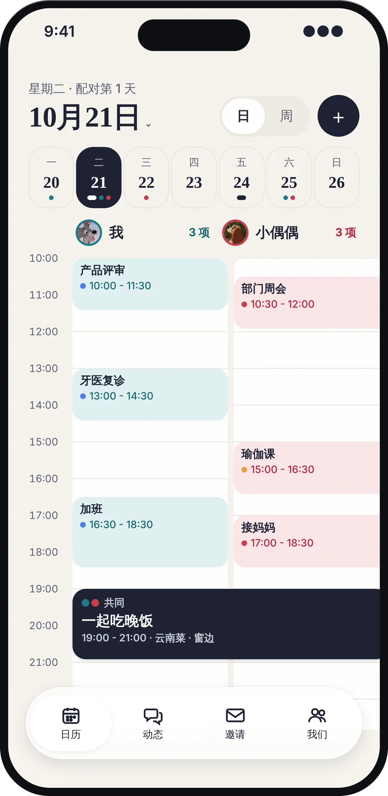
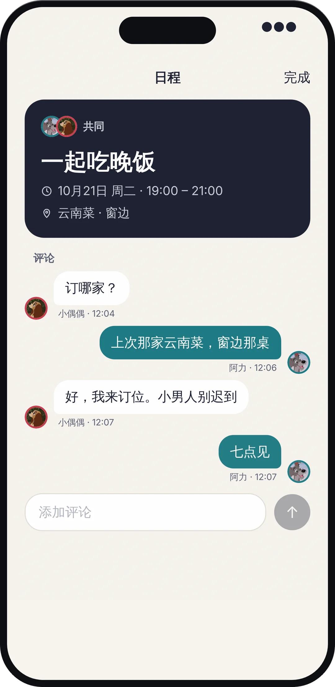
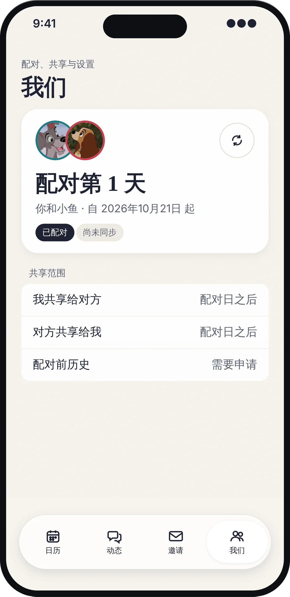
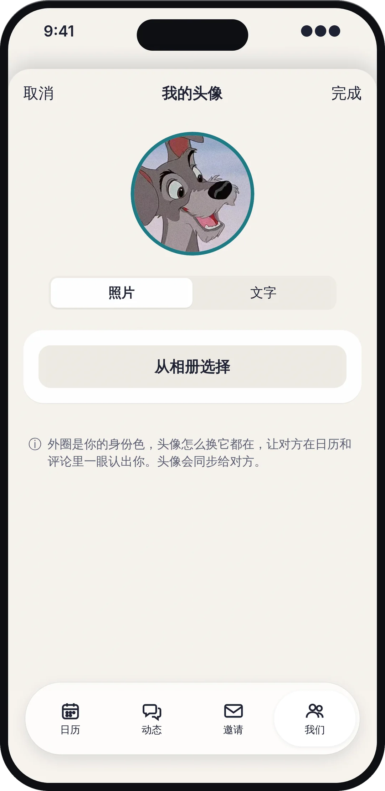
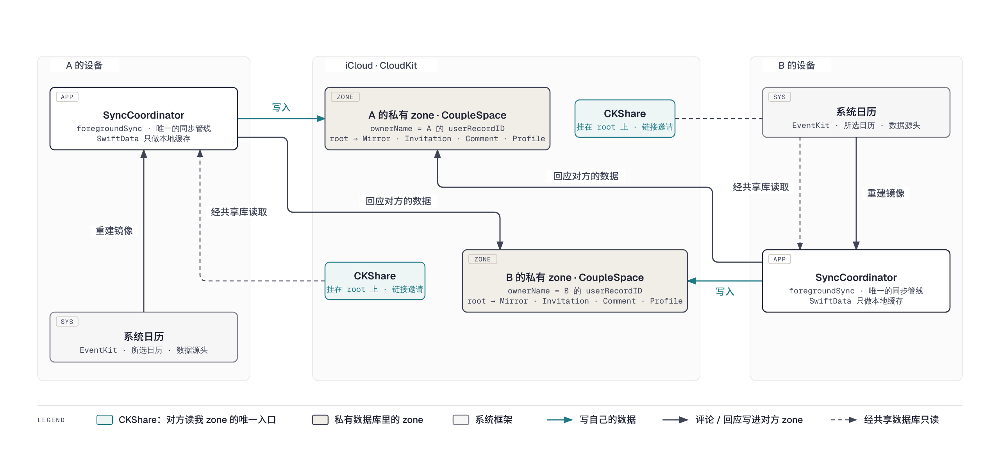
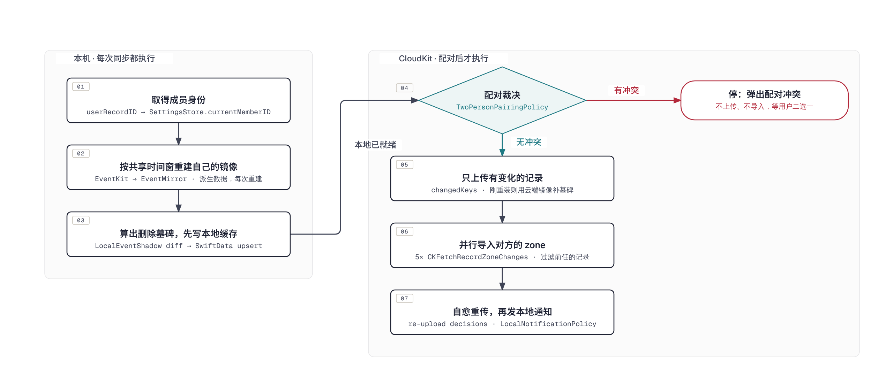

# OurDays（CoupleCalendar）

OurDays（原名 ShareCal）是一款**严格两人配对**的情侣共享日历 iOS App：双方各自挑选要共享的系统日历，App 将所选日程镜像到 iCloud 并通过一条 CKShare 互相可见。不上传账号密码、不依赖任何自建服务器——所有数据只存在于两个人自己的 iCloud 中。

[](https://apps.apple.com/cn/app/id6772868166)
[](https://ourdays.cn)
[](LICENSE)
[](https://github.com/BeenLi/OurDays/actions/workflows/ios-ci.yml)

**完全开源、永久免费、没有服务器。** 数据放在用户自己的 iCloud 里，项目唯一的固定开销是每年的 Apple 开发者账号费用，因此不需要靠订阅或广告维持。

## 功能特性

- **两人配对**：通过 iCloud 共享链接配对，双向各建一条 CKShare。配对后若有第三人经旧链接加入、或收到陌生人的分享，App 不会悄悄踢人，而是弹出"配对冲突 / 更换配对"让你二选一；多余的历史共享 zone 自动退出。**解除配对**会删掉我的 CKShare，并把前任留在我 zone 里的评论、邀请和历史申请一并清掉，不会带进下一段配对。
- **日程同步**：从系统日历（EventKit）镜像所选日历的日程；每条日程四档可见性（完整详情 / 标题+地点 / 仅忙碌 / 隐藏）。本地日历的增删改在每次同步时自动收敛（删除以墓碑形式传给对方），后台由 iCloud 静默推送 + 后台刷新尽力补同步。
- **日程邀请**：给对方发日程邀请，对方接受后自动写入其系统日历；状态（待处理 / 已接受 / 已拒绝 / 已取消）双向同步。只能为**尚未结束**的日程发邀请；日程结束仍无人回应的邀请在两端都显示为"已过期"；发起方可随时**撤销**待处理的邀请。
- **日程评论与动态**：对任意一方的日程留言，支持编辑、删除与已读状态；自己的日程**还没同步也能先发起评论**，对方收到后接续回复。"动态" Tab 按事件聚合双方评论，气泡带各自头像，未读数显示在 Tab 角标。
- **系统通知**：对方评论我的日程、收到 / 被回应邀请、历史申请及其回复会推送本地通知（仅这四类，纯日历改动不打扰）。
- **历史日历申请**：默认只共享配对日之后的日程；想看配对前的历史需向对方发起申请，对方批准后按时间窗放行。
- **昵称与头像**：对方显示为"备注名 > 对方同步的昵称 > 兜底"，头像可选图片或文字+底色并随 iCloud 同步，不展示邮箱等 iCloud 身份信息。"我们"页显示配对第 N 天。
- **删除重装可恢复**：配对、评论、邀请都在自己的 iCloud 里。重装后首次启动若检测到已有数据，选「继续使用现有 iCloud 数据」即可找回配对日、昵称头像，不用重新配对；App 不在期间删掉的日程也会补发墓碑，对方那边不会残留。
- **中英双语**：内置中 / 英文案，可在设置中切换。

## 产品 UI

App 为四个 Tab 的标准 iOS 结构：

| Tab | 内容 |
| --- | --- |
| **日历** | 日 / 周视图，"我"与"对方"双列时间轴，重叠日程并列展示，被接受的邀请以共同日程横跨两列；点击日程查看详情与评论 |
| **动态** | 跨日程的评论动态流，按事件聚合、最新在前；未读（对方新评论）数显示在 Tab 角标 |
| **邀请** | 收到的日程邀请与历史日历申请的待办列表（Tab 角标提示未处理数量），已处理 / 已过期的沉到下方 |
| **我们** | 配对状态卡（发起配对 / 解除配对 / 同步 / 申请历史 / 配对第 N 天）、昵称、备注与头像、共享日历选择、默认可见性、语言、删除 iCloud 数据 |

| 双栏日视图 | 日程详情与评论 | 我们：配对第 N 天 | 昵称与头像 |
| --- | --- | --- | --- |
|  |  |  |  |

## 技术栈

| 层 | 技术 |
| --- | --- |
| UI | SwiftUI（`@Observable`），无第三方依赖 |
| 本地存储 | SwiftData（仅作本地缓存，`cloudKitDatabase: .none`）+ UserDefaults（设置与配对状态） |
| 云同步 | CloudKit 原生 API（`CKModifyRecordsOperation` 写、`CKFetchRecordZoneChangesOperation` 读）：私有数据库自有 `CoupleSpace` zone + CKShare 层级共享；两条 `CKDatabaseSubscription` 静默推送 + `BGAppRefresh` 兜底。**不使用 CKSyncEngine、不使用 SwiftData 的 CloudKit 自动同步** |
| 系统日历 | EventKit（读取所选日历、为接受的邀请创建日程） |
| 身份 | CloudKit `userRecordID` 作为唯一成员 ID（即共享 zone 的 ownerName，无自建账号体系） |
| 测试 | XCTest 单测（约 300 个用例，决策逻辑收敛在无状态 "Policy enum" 中直接单测）+ 少量 XCUITest + 双模拟器配对冒烟脚本 |
| 最低系统 | iOS 18.0 |

## 数据同步架构

两人各自拥有一个私有 `CoupleSpace` zone，所有记录挂在 `couple-space-root` 根记录下，由一条 CKShare 整体共享给对方；对方通过共享数据库（sharedCloudDatabase）只读。**zone 的 ownerName 就是数据归属的权威身份。**



- **写入路径规则**：自己的数据写自己的私有 zone；针对对方数据的回应（评论、邀请状态、申请批复）写进对方的共享 zone。
- **镜像是派生数据**：自己的 EventMirror 每次同步都从 EventKit 重建，SwiftData 只是缓存。
- **mirrorKey 是跨设备的稳定锚点**：`日历ID:事件ID:发生时刻` 同时是 SwiftData 的 id、CloudKit 的 recordName 和评论线程的键，两端生成规则相同，所以还没同步的日程也能先被评论。

### 记录类型

CloudKit 里只有 6 种记录类型（schema 见 [`CloudKit/ShareCalSchema.ckdb`](CloudKit/ShareCalSchema.ckdb)），全部以 `couple-space-root` 为 parent，因此一条 CKShare 就覆盖整个 zone：

| 记录 | 作用 | 谁写、写到哪 |
| --- | --- | --- |
| `CoupleSpace` | 根记录 `couple-space-root`，只存 `ownerMemberID`，CKShare 挂在它上面 | 自己写自己的 zone |
| `EventMirror` | 系统日历日程的镜像，recordName = `mirrorKey`（`日历ID:事件ID:发生时刻`），带可见性与 `deletedAt` 墓碑 | 自己写自己的 zone；对方只读 |
| `MemberProfile` | 昵称 + 头像（图片 bytes / 文字 / 底色） | 自己写自己的 zone |
| `EventInvitation` | 日程邀请及其状态；历史日历申请复用此类型，以 `history-access-request:` 前缀区分（避免再部署一种记录类型） | 发起方写自己的 zone，回应方把状态写回发起方的共享 zone |
| `EventComment` | 评论，`eventMirrorID` 指向所评论的 mirrorKey（共同日程指向邀请 id） | 评论自己的日程写自己的 zone；评论对方的日程写对方的共享 zone |
| `CalendarAccessRequest` | 历史日历申请的本地模型；云端以上面的 Invitation 前缀记录传输 | 同邀请 |

本地 SwiftData 还有一个不上云的 `LocalEventShadow`：记录每条本地日程上次成功上传时的指纹与 `lastUploadedAt`，是"只上传有变化的 mirror"和"检测本地删除"的依据。

### 数据安全

**数据在哪里？** 只在两个地方：你自己 iCloud 私有数据库里的 `CoupleSpace` zone（上面那张表的全部记录），以及手机上的 SwiftData 缓存 + UserDefaults 设置。没有任何服务器经手，开发者也看不到任何人的数据。系统日历本身不被修改，App 只读取所选日历；唯一的写入是把你接受的邀请创建成日程。对方能看到的，只有你的 CKShare 共享给他的那一个 zone，而且是只读。

**App 升级后数据还在吗？** 在。升级不动 iCloud，本地缓存走 SwiftData 轻量迁移，配对状态保存在 UserDefaults 里；就算缓存损坏，下次同步也会从 EventKit 和对方的 zone 重建出来。CloudKit schema 在发版前部署到 Production，新字段对旧版本只是"看不见"，不会互相破坏。

**解除配对后数据有什么变化？** 「我们」页的解除配对按顺序做三件事：删除我的 CKShare（对方立刻失去读我 zone 的权限）；从我的私有 zone 删掉所有**不是我写的评论**以及**全部**邀请和历史申请记录（两人空间里这些必然与前任有关，我写在自己日程上的评论保留）；清掉本地缓存里对方的镜像、评论、邀请和配对状态。对方那一侧的 share 不动，由对方自己解除。之所以要删 zone 里的记录，是因为下一条 CKShare 会把整个 zone 原样共享给下一个人；即使这一步失败（比如离线），同步导入时的 `PartnerScopedDataPolicy` 仍会把"另一方既不是我也不是当前对方"的记录挡在外面，双保险。配对冲突里选择"换成新来的人"走同一条清理路径。

**删除 App 后数据有什么变化？** 手机上的缓存和设置随 App 一起没了，iCloud 里的 zone、share 和对方的 share 都还在。重装后首次启动，App 探测到这个 Apple ID 下已有数据，会弹「继续使用现有 iCloud 数据」或「删除」二选一，在你决定前不自动同步。选继续：从根记录的创建时间恢复配对日，从自己的 `MemberProfile` 恢复昵称与头像，配对不需要重做；第一次同步会用云端自己的镜像做一遍删除比对，把 App 不在期间从系统日历删掉的日程补上墓碑，对方不会一直看到幽灵日程（`OwnMirrorReconciliationPolicy`）。真正的全清是「删除我的 iCloud 数据」：删我的 share、删整个私有 zone、退出对方的 share、清本地，系统日历不受影响。

### 一次同步做了什么

整个 App 只有一条同步管线 `SyncCoordinator.foregroundSync`，前台和后台触发走同一段代码，全程在 main actor 上串行。顺序是刻意的：本机能算的先算完，**先裁决配对再碰云**，有冲突时一个字节也不上传、不导入，避免把新数据泄露给即将被拒绝的人。



几处值得知道的细节：

- 第 03 步的"删除"来自 `LocalEventShadow`：它记着每条本地日程上次成功上传时的指纹，消失的日程生成带 `deletedAt` 的墓碑，移出共享时间窗的做硬删除。
- 第 05 步只上传 shadow 判定有变化的 mirror；根记录和 `MemberProfile` 只在字段真的变了时才保存。CloudKit 的记录只要 `save` 就会触发对方的订阅推送，哪怕没改字段，所以"每次都保存"会让两台手机互相唤醒、耗尽静默推送预算。
- 第 06 步五路请求同时发，每路都是 change token 置空的 `CKFetchRecordZoneChangesOperation`（按 zone 全量拉、客户端按记录类型过滤、只取 `desiredKeys`）；导入时 `ownerMemberID` 一律覆盖为 zone 的 ownerName。
- 第 07 步：Tab 里的"接受 / 拒绝 / 批准"是乐观写入、一次性上传，上传失败的决定在这里重传；之后只为四类事件（对方评论我的日程、收到邀请、邀请被回应、历史申请及回复）发本地通知。

### 同步什么时候触发

- **打开 App、切 Tab、编辑完成**：界面调用 `SyncCoordinator.syncIfIdle`；自动同步距上次至少 60 s，手动下拉或点"同步"不受限。
- **对方写了数据**：私有库和共享库各一条 `CKDatabaseSubscription`，发 content-available 静默推送，`ShareCalBackgroundSyncRunner.runSync` 立即跑一遍完整管线，不受 60 s 节流。
- **推送被系统丢弃**：`BGAppRefreshTask` 兜底，每次运行先排下一次；iOS 的最短间隔约 15 min。

推送做成静默而不是可见通知，是因为数据库订阅对 zone 里任何记录变化都会触发、无法按类型过滤；由同步完成后的 `LocalNotificationPolicy` 决定哪些变化值得打扰用户。

## 开发

```bash
# 构建
xcodebuild -project CoupleCalendar.xcodeproj -scheme CoupleCalendar \
  -destination 'platform=iOS Simulator,name=iPhone 17 Pro' build

# 单元测试
xcodebuild -project CoupleCalendar.xcodeproj -scheme CoupleCalendar \
  -destination 'platform=iOS Simulator,name=iPhone 17 Pro' test -only-testing:CoupleCalendarTests

# 把 CloudKit schema 导入 Development 环境（Production 在 CloudKit Console 部署）
Scripts/import-cloudkit-schema.sh development

# 双模拟器配对冒烟测试（需要两台已登录 iCloud 的固定模拟器，见 docs/development.md）
Scripts/dev-pairing-smoke.sh
```

Debug 配置带 `LOCAL_SIGNING` 编译条件，CloudKit 整体关闭（`AppServices.isCloudKitEnabled == false`），本地无开发者账号也能跑 UI；冒烟脚本会用覆盖的 entitlements 构建以连 Development 环境。Release 使用 Production 环境。

### 代码结构

`CoupleCalendar/` 下没有第三方依赖，按分层分目录，依赖方向固定为 **Views → Services → Policies → Models**，Policies 从不反向引用服务或存储（2026-10 重构后文件级反向依赖为 0）：

```text
OurDays/
├── CoupleCalendar/                按分层分目录，依赖只能向下：App → Views → Services → Policies → Models
│   ├── App/                       入口与进程级对象
│   │   ├── CoupleCalendarApp.swift        @main、AppDelegate：BGTask 注册、静默推送入口、通知授权
│   │   ├── ShareCalSceneDelegate.swift    场景代理、CKShare 接受处理、更换配对确认
│   │   ├── AppServices.swift              服务容器
│   │   └── Info.plist、*.entitlements     Debug/Local/Production 三套 entitlements
│   ├── Models/
│   │   └── Models.swift                   SwiftData 模型（EventMirror、LocalEventShadow、EventInvitation、EventComment、CalendarAccessRequest、MemberProfile）与本地清理
│   ├── Policies/                  "Policy" = 只做决定、不动手：无状态 enum + 纯 static 函数，输入值、输出"该怎么办"，不碰 I/O；服务层按它的答案执行
│   │   ├── PairingPolicies.swift          TwoPersonPairingPolicy、ShareAcceptanceGuardPolicy、ExistingICloudDataRecoveryPolicy（重装恢复）、PartnerScopedDataPolicy（前任数据过滤）
│   │   ├── SyncPolicies.swift             ForegroundSyncPolicy（节流）、CloudKitMirrorSyncPolicy（哪些 mirror 要上传）、OwnMirrorReconciliationPolicy（重装补墓碑）、BackgroundRefreshSchedulePolicy
│   │   ├── CloudKitPolicies.swift         写入去向、共享层级、根记录元数据、导入过滤、停止共享、解除配对时清理前任记录
│   │   ├── InvitationAndAccessRequestPolicies.swift  邀请时效/撤销/合并/重传、历史申请、配对日、共享时间窗
│   │   ├── CommentPolicies.swift          评论线程锚点（mirrorKey / 邀请 id）、详情页是否可评论、红点
│   │   ├── ActivityAndNotificationPolicies.swift     动态流聚合、LocalNotificationPolicy（四类通知）
│   │   ├── CalendarSourcePolicies.swift   EventKit 授权状态、EventMirrorKeyPolicy、日历选择
│   │   ├── CalendarDisplayPolicies.swift  时间文案、DateFormatterCache、CalendarDisplayMirrorPolicy（自己日程的即时展示）
│   │   ├── CalendarNavigationPolicies.swift / DayTimelinePolicies.swift / AgendaPolicies.swift  日期导航、双列布局、共同日程、周议程
│   │   └── MemberIdentityPolicies.swift   MemberIDPolicy 归一化、头像与显示名
│   ├── Services/                  动手的一层：I/O、持久化、同步管线；决策都问 Policies
│   │   ├── SyncCoordinator.swift          foregroundSync：唯一的同步管线；ShareCalBackgroundSyncRunner（推送 / BGAppRefresh 入口）；通知调度
│   │   ├── CloudKitCoupleSpaceService.swift   全部 CloudKit I/O：zone / root / share / 订阅 / 查询 / 写入
│   │   ├── CloudKitRecordMappers.swift    CKRecord ↔ 模型 的纯映射（只写变化字段）、批量 upsert 与查询策略
│   │   ├── CalendarAccessService.swift    EventKit 访问
│   │   ├── EventServices.swift            EventMirrorService / InvitationService / CommentService：生成与变更，不含决策
│   │   └── SettingsStore.swift            UserDefaults 持久化的设置与配对状态（@Observable）
│   ├── Views/                     SwiftUI 界面，一屏一文件（仅 App target）
│   │   ├── RootView.swift                 四 Tab 容器、sheet/alert 路由、配对冲突与已有 iCloud 数据弹窗
│   │   ├── CalendarTabView.swift          日历 Tab：日/周切换、双列时间轴容器
│   │   ├── DayTimeline/                   对齐的双列日视图：Lane（单列）、Chrome（时间轴/当前时刻线）
│   │   ├── WeekAgendaView.swift           周议程
│   │   ├── EventDetail/                   日程详情 + 评论区
│   │   ├── ActivityTabView.swift          动态 Tab
│   │   ├── InvitesTabView.swift           邀请 Tab（邀请 + 历史申请）
│   │   ├── CreateInviteView.swift         发起邀请
│   │   ├── Settings/                      我们 Tab：SettingsTabView、PairingStatusCard、AvatarEditorSheet、HistoryRequestSheet
│   │   ├── OnboardingSheets.swift         首次启动引导、配对安全说明
│   │   ├── HierarchicalDatePickerSheet.swift  年/月/日层级选日期
│   │   ├── DesignSystem.swift             OurDaysTheme、卡片/按钮样式、头像视图
│   │   └── CloudSharingController.swift   UICloudSharingController 封装
│   ├── Diagnostics/               仅由启动参数驱动的探针与冒烟工具，正常运行不使用
│   └── Resources/
│       ├── Assets.xcassets                图标、颜色
│       └── ShareCalStrings.swift          手写中英文案
├── CoupleCalendarTests/           XCTest，一个领域一个文件，直接编译非 UI 源码（无 @testable import）
│                                  PairingTests / CloudKitTests / SyncTests / CalendarMirrorTests /
│                                  InvitationAndAccessRequestTests / CommentTests /
│                                  DayTimelineAndNavigationTests / ActivityAndNotificationTests / SettingsAndStringsTests
├── CoupleCalendarUITests/         XCUITest：启动、滑动切日、首次引导，以及（配对模拟器上）对方日程与评论线程
├── CoupleCalendar.xcodeproj       唯一的 scheme CoupleCalendar；App、单测、UI 测试三个 target
├── CloudKit/ShareCalSchema.ckdb   CloudKit schema 源文件
├── Scripts/                       CloudKit schema 导入、双模拟器配对冒烟脚本、App Store / TestFlight 导出配置
├── docs/                          开发流程、隐私政策、官网源码（docs/site）、README 架构图源文件（docs/diagrams）、审核记录、规划树（docs/plantree）
├── .github/workflows/ios-ci.yml   CI：macOS runner 构建并跑全部测试
└── CLAUDE.md                      代码架构与约定（身份模型、CloudKit 布局、Policy 约定）
```

"Policy" 是这个代码库的核心约定：所有决策逻辑写成 `enum XxxPolicy` 里的纯 static 函数（例如 `TwoPersonPairingPolicy.resolve` 输入三组 ID，输出"对方是谁、该退出哪些 zone、有没有冲突"），自己不发请求、不读写存储；`SyncCoordinator` 和各 Service 先问 Policy 再执行。单元测试因此几乎只测 Policies，不需要模拟 CloudKit。

新增非 UI 文件时要同时加进 App 和 Test 两个 target（test target 直接编译源码）；UI 文件只进 App target。

- 代码架构与约定（身份模型、CloudKit 布局、Policy 约定、共享 helper）见 [CLAUDE.md](CLAUDE.md)。
- CloudKit Schema 部署、固定双模拟器冒烟测试、停止共享隐私验证等运维流程见 [docs/development.md](docs/development.md)。
- CI：[`.github/workflows/ios-ci.yml`](.github/workflows/ios-ci.yml) 在 macOS runner 上构建并跑全部单元与 UI 测试（push 到 main 与针对 main 的 PR）。冒烟测试需要登录 iCloud 的模拟器，只在本地跑。

## 开源协议

本项目采用 [MIT 协议](LICENSE) 开源，可自由使用、修改与分发，仅需保留版权与许可声明。

## 致谢

- [SeemSeam/plan-tree](https://github.com/SeemSeam/plan-tree) —— 本项目开发时使用的规划工作流 skill（作为本地工具使用，不随仓库分发），感谢其作者。
