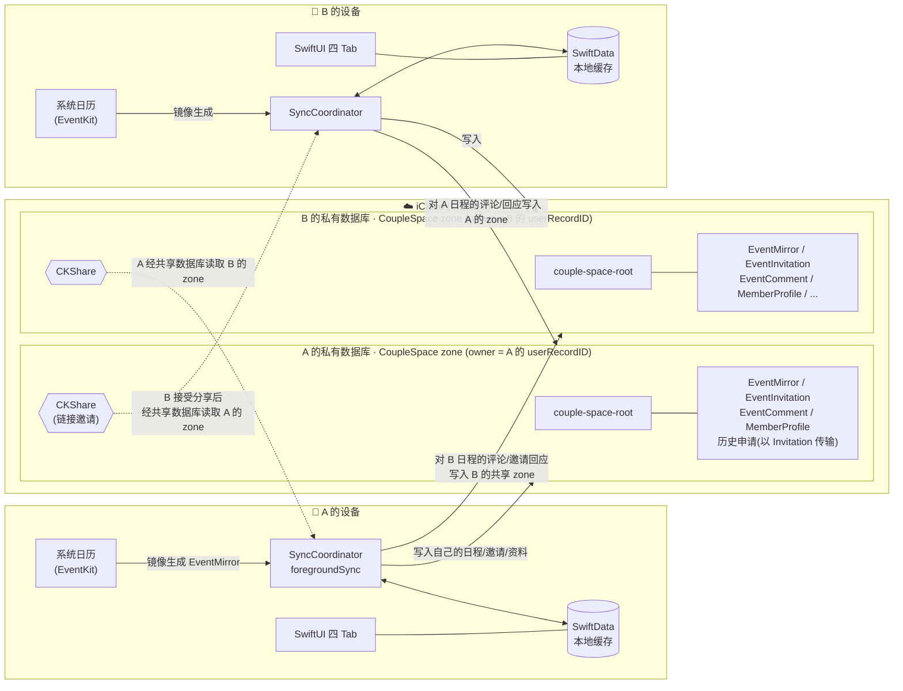
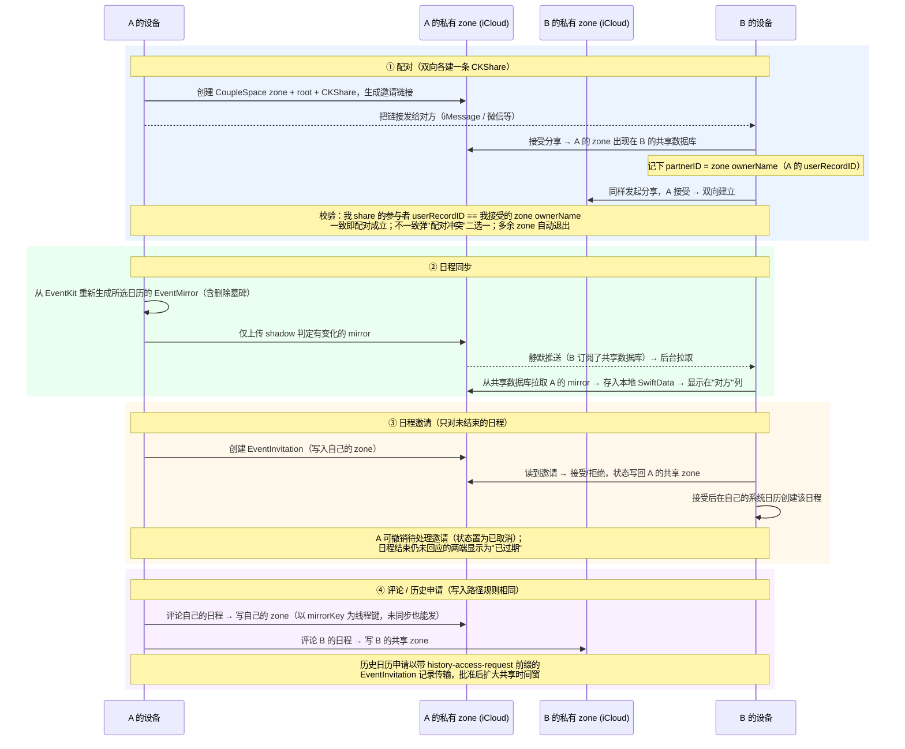

# OurDays（CoupleCalendar）

OurDays（原名 ShareCal）是一款**严格两人配对**的情侣共享日历 iOS App：双方各自挑选要共享的系统日历，App 将所选日程镜像到 iCloud 并通过一条 CKShare 互相可见。不上传账号密码、不依赖任何自建服务器——所有数据只存在于两个人自己的 iCloud 中。

[](https://apps.apple.com/cn/app/id6772868166)
[](https://ourdays.cn)
[](LICENSE)
[](https://github.com/BeenLi/OurDays/actions/workflows/ios-ci.yml)

**完全开源、永久免费、没有服务器。** 数据放在用户自己的 iCloud 里，项目唯一的固定开销是每年的 Apple 开发者账号费用，因此不需要靠订阅或广告维持。

## 功能特性

- **两人配对**：通过 iCloud 共享链接配对，双向各建一条 CKShare。配对后若有第三人经旧链接加入、或收到陌生人的分享，App 不会悄悄踢人，而是弹出"配对冲突 / 更换配对"让你二选一；多余的历史共享 zone 自动退出。**解除配对**会删掉我的 CKShare，并把前任留在我 zone 里的评论、邀请和历史申请一并清掉，不会带进下一段配对。
- **日程同步**：从系统日历（EventKit）镜像所选日历的日程；每条日程四档可见性（完整详情 / 标题+地点 / 仅忙碌 / 隐藏）。本地日历的增删改在每次同步时自动收敛（删除以墓碑形式传给对方），后台由 iCloud 静默推送 + 后台刷新尽力补同步。
- **日程邀请**：给对方发日程邀请，对方接受后自动写入其系统日历；状态（待处理 / 已接受 / 已拒绝 / 已取消）双向同步。只能为**尚未结束**的日程发邀请；日程结束仍无人回应的邀请在两端都显示为"已过期"；发起方可随时**撤销**待处理的邀请。
- **日程评论与动态**：对任意一方的日程留言，支持编辑、删除与已读状态；自己的日程**还没同步也能先发起评论**，对方收到后接续回复。"动态" Tab 按事件聚合双方评论，气泡带各自头像，未读数显示在 Tab 角标。
- **系统通知**：对方评论我的日程、收到 / 被回应邀请、历史申请及其回复会推送本地通知（仅这四类，纯日历改动不打扰）。
- **历史日历申请**：默认只共享配对日之后的日程；想看配对前的历史需向对方发起申请，对方批准后按时间窗放行。
- **昵称与头像**：对方显示为"备注名 > 对方同步的昵称 > 兜底"，头像可选图片或文字+底色并随 iCloud 同步，不展示邮箱等 iCloud 身份信息。"我们"页显示配对第 N 天。
- **删除重装可恢复**：配对、评论、邀请都在自己的 iCloud 里。重装后首次启动若检测到已有数据，选「继续使用现有 iCloud 数据」即可找回配对日、昵称头像，不用重新配对；App 不在期间删掉的日程也会补发墓碑，对方那边不会残留。
- **中英双语**：内置中 / 英文案，可在设置中切换。

## 产品 UI

App 为四个 Tab 的标准 iOS 结构：

| Tab | 内容 |
| --- | --- |
| **日历** | 日 / 周视图，"我"与"对方"双列时间轴，重叠日程并列展示，被接受的邀请以共同日程横跨两列；点击日程查看详情与评论 |
| **动态** | 跨日程的评论动态流，按事件聚合、最新在前；未读（对方新评论）数显示在 Tab 角标 |
| **邀请** | 收到的日程邀请与历史日历申请的待办列表（Tab 角标提示未处理数量），已处理 / 已过期的沉到下方 |
| **我们** | 配对状态卡（发起配对 / 解除配对 / 同步 / 申请历史 / 配对第 N 天）、昵称、备注与头像、共享日历选择、默认可见性、语言、删除 iCloud 数据 |

| 双栏日视图 | 日程详情与评论 | 我们：配对第 N 天 | 昵称与头像 |
| --- | --- | --- | --- |
|  |  |  |  |

## 技术栈

| 层 | 技术 |
| --- | --- |
| UI | SwiftUI（`@Observable`），无第三方依赖 |
| 本地存储 | SwiftData（仅作本地缓存，`cloudKitDatabase: .none`）+ UserDefaults（设置与配对状态） |
| 云同步 | CloudKit 原生 API（`CKModifyRecordsOperation` 写、`CKFetchRecordZoneChangesOperation` 读）：私有数据库自有 `CoupleSpace` zone + CKShare 层级共享；两条 `CKDatabaseSubscription` 静默推送 + `BGAppRefresh` 兜底。**不使用 CKSyncEngine、不使用 SwiftData 的 CloudKit 自动同步** |
| 系统日历 | EventKit（读取所选日历、为接受的邀请创建日程） |
| 身份 | CloudKit `userRecordID` 作为唯一成员 ID（即共享 zone 的 ownerName，无自建账号体系） |
| 测试 | XCTest 单测（约 300 个用例，决策逻辑收敛在无状态 "Plan enum" 中直接单测）+ 少量 XCUITest + 双模拟器配对冒烟脚本 |
| 最低系统 | iOS 18.0 |

## 数据同步架构

两人各自拥有一个私有 `CoupleSpace` zone，所有记录挂在 `couple-space-root` 根记录下，由一条 CKShare 整体共享给对方；对方通过共享数据库（sharedCloudDatabase）读取。**zone 的 ownerName 就是数据归属的权威身份**。



### 记录类型

CloudKit 里只有 6 种记录类型（schema 见 [`CloudKit/ShareCalSchema.ckdb`](CloudKit/ShareCalSchema.ckdb)），全部以 `couple-space-root` 为 parent，因此一条 CKShare 就覆盖整个 zone：

| 记录 | 作用 | 谁写、写到哪 |
| --- | --- | --- |
| `CoupleSpace` | 根记录 `couple-space-root`，只存 `ownerMemberID`，CKShare 挂在它上面 | 自己写自己的 zone |
| `EventMirror` | 系统日历日程的镜像，recordName = `mirrorKey`（`日历ID:事件ID:发生时刻`），带可见性与 `deletedAt` 墓碑 | 自己写自己的 zone；对方只读 |
| `MemberProfile` | 昵称 + 头像（图片 bytes / 文字 / 底色） | 自己写自己的 zone |
| `EventInvitation` | 日程邀请及其状态；历史日历申请复用此类型，以 `history-access-request:` 前缀区分（避免再部署一种记录类型） | 发起方写自己的 zone，回应方把状态写回发起方的共享 zone |
| `EventComment` | 评论，`eventMirrorID` 指向所评论的 mirrorKey（共同日程指向邀请 id） | 评论自己的日程写自己的 zone；评论对方的日程写对方的共享 zone |
| `CalendarAccessRequest` | 历史日历申请的本地模型；云端以上面的 Invitation 前缀记录传输 | 同邀请 |

本地 SwiftData 还有一个不上云的 `LocalEventShadow`：记录每条本地日程上次成功上传时的指纹与 `lastUploadedAt`，是"只上传有变化的 mirror"和"检测本地删除"的依据。

### 一次同步做了什么

整个 App 只有一条同步管线 `SyncCoordinator.foregroundSync`，不论前台还是后台触发都走同一段代码，全程在 main actor 上串行，天然互斥：

1. **身份**：首次需要 CloudKit 时取 `userRecordID` 作为自己的成员 ID；若取不到（未登录 iCloud），本次只做本地部分。
2. **重建自己的镜像**：按"共享时间窗"（配对日起 + 已批准的历史时间窗）从 EventKit 读所选日历，重新生成全部 `EventMirror`。镜像是派生数据，每次都从源重建，不做增量 diff。
3. **算出删除**：与 `LocalEventShadow` 和上次的本地 mirror 对比，消失的日程生成带 `deletedAt` 的墓碑；移出时间窗的日程做硬删除。
4. **写本地缓存**：mirror、shadow 先落 SwiftData，UI 立刻可用；接受过但本地日程已被用户删掉的邀请标为已取消。
5. **先裁决配对再碰云**：并行取"我的 share 有哪些参与者"和"我接受了谁的 zone"，交给 `TwoPersonPairingPlan.resolve`。有冲突（陌生人加入、多条 share）就停在这里弹窗，**一个字节也不上传、不导入**，避免把新数据泄露给即将被拒绝的人。
6. **上传变化**：只上传 shadow 判定有变化的 mirror、墓碑、硬删除、取消的邀请和待发的历史申请；写完才给 shadow 盖 `lastUploadedAt`。根记录和 `MemberProfile` 只在字段真的变了时才保存（见下文"为什么要只写变化"）。若本机还没有任何一次确认成功的上传（刚重装），则额外把云端自己的 mirror 当作"上次状态"做一遍删除比对，补发墓碑（`OwnMirrorReconciliationPlan`）。
7. **退出多余 zone**：裁决出的陈旧共享 zone 删掉，并清掉其本地数据。
8. **并行导入对方 zone**：mirror、评论、邀请、历史申请、资料五路请求同时发（每路都是一次 change token 置空的 `CKFetchRecordZoneChangesOperation`，即按 zone 全量拉取、客户端按记录类型过滤，并只要 `desiredKeys` 里的字段）；导入时记录的 `ownerMemberID` 一律覆盖为 zone 的 ownerName（zone 拥有者才是权威）；对方已删的 mirror 从本地清掉。评论、邀请、历史申请在导入前经 `PartnerScopedDataPlan` 过滤：另一方既不是我也不是当前对方的记录（前任留下的）一律丢弃，本地已有的同类数据也顺手清掉。
9. **自愈**：Tab 里"接受 / 拒绝 / 批准"是乐观写入、一次性上传，若上次上传失败，这一步把本地已决定但云端还没跟上的状态重传；新建邀请靠 `needsCloudKitUpload` 标志重传。
10. **通知**：对比上次高水位，只为四类事件（对方评论我的日程、收到邀请、邀请被回应、历史申请及回复）发本地通知，再推进高水位。



### 同步什么时候触发

| 触发 | 机制 | 节流 |
| --- | --- | --- |
| 打开 App / 切到某个 Tab / 编辑完成 | 界面调用 `SyncCoordinator.syncIfIdle` | 自动同步距上次至少 60 s（`ForegroundSyncPlan.automaticThrottleInterval`）；手动下拉 / 点"同步"不受限 |
| 对方写了数据 | 两条 `CKDatabaseSubscription`（私有库一条、共享库一条）发 **content-available 静默推送**，`AppDelegate` 收到后调用 `ShareCalBackgroundSyncRunner.runSync` | 推送本身就是"有新数据"的信号，直接跳过 60 s 节流 |
| 推送被系统丢弃 / 节流 | `BGAppRefreshTask`（`com.leeberty.CoupleCalendar.refresh`），每次运行先排下一次 | iOS 对后台刷新的最短间隔约 15 min，代码按此下限请求 |

为什么是静默推送而不是可见推送：数据库订阅对 zone 里**任何**记录变化都会触发，无法按记录类型过滤，若做成可见通知就只能是一句笼统的"有新动态"，而且对方改一下日程也会响。所以推送只负责唤醒，由 `LocalNotificationPlan` 在同步完成后决定哪些变化值得打扰用户。

### 为什么要只写变化

CloudKit 的 `savePolicy: .changedKeys` 只跳过"没改过的字段"，但 `CKRecord` 一旦被 `save`，哪怕没有字段变化也会生成新的服务端版本并**触发对方的订阅推送**。1.5 之前每次同步都重新保存根记录和 `MemberProfile`（`updatedAt = now`），于是 A 同步 → B 收到推送 → B 同步时又保存了自己的根记录 → A 收到推送 → …… 两台手机互相唤醒，白白耗尽 iOS 的静默推送预算，真正的变化反而被延迟。现在：

- `CloudKitShareRootMetadataPlan.applyOwnerMemberID` 和 `MemberProfileRecordMapper.apply` 只写与已取回记录不同的字段，返回"是否变了"；没变就不 `save`。
- `EventMirror` 的上传由 `LocalEventShadow` 的指纹决定，未变的日程不会重复上传。
- 新增任何写入共享记录的路径时，都应沿用"先比对再保存"的模式，否则会重新引入这个循环。

### 解除配对与重装时发生什么

两件事都围绕一个事实：**我的私有 zone 里不只有我的数据**。对方对我日程的评论、我们互发的邀请和历史申请，都写在我的 zone 里（见上面的记录类型表），而下一条 CKShare 会把整个 zone 原样共享给下一个人。

**解除配对**（我们 Tab → 解除配对）按顺序做三步：

1. 删除我的 CKShare：对方立刻失去读我 zone 的权限（对方那边的 share 不动，由对方自己解除）。
2. `purgeExPartnerRecordsFromPrivateZone`：从我的私有 zone 删掉所有**不是我写的评论**，以及**全部**邀请和历史申请记录。两人空间里这些记录必然和前任有关，而我自己写在自己日程上的评论是我的，保留。
3. 清本地：对方的 mirror、评论、邀请、历史申请和配对状态全部删除。

即使第 2 步失败（例如离线），同步导入时的 `PartnerScopedDataPlan` 过滤仍会把前任的记录挡在 UI 之外，所以是"删一遍 + 过滤一遍"的双保险。配对冲突里选择"换成新来的人"走同一条清理路径。「删除我的 iCloud 数据」则是整 zone 全删，不在此列。

**删除 App 再重装**时本地缓存全空，但 iCloud 里一切都在。首次启动完成昵称设置后，App 探测到这个 Apple ID 下已有私有 zone 数据 / 发出去的 share / 接受过的 share，就弹「继续使用现有 iCloud 数据」或「删除」二选一，在用户决定前**不自动同步**（`ExistingICloudDataRecoveryPlan`）。选择继续后：

- 从根记录的创建时间恢复配对日，从自己的 `MemberProfile` 恢复昵称与头像（常规同步只读对方的 zone，不会读这两样，所以单独恢复一次）。
- 第一次同步时本机还没有任何带 `lastUploadedAt` 的 shadow，`OwnMirrorReconciliationPlan` 据此判断"没有可信的上次状态"，改为拉取云端自己的 mirror 来做删除比对：App 不在期间从系统日历删掉的日程，由此补发墓碑，对方不会一直看到幽灵日程。
- 配对本身不需要重做：对方的 share 还在我的共享数据库里，我的 share 参与者也没变，`TwoPersonPairingPlan` 照常裁决出对方。

### 为什么不用 CKSyncEngine

早期版本曾挂过一个 `CKSyncEngine` 驱动，但它从未真正承担写入，只是额外注册了订阅、与手写管线各跑一套状态。2026-10 的重构把它删掉了，理由是：

- 这个 App 的"真相"在系统日历里，自己的镜像每次都从 EventKit 重建，不需要引擎维护本地变更队列。
- 两人制的配对裁决必须发生在**任何上传之前**（冲突时一个字节都不能传），引擎的自动推送模型放不进这个前置条件。
- 对方的数据只读，每次把对方的 zone 全量拉一遍（`CKFetchRecordZoneChangesOperation` 不带 change token）比持久化 token、处理 token 过期更容易推理，而且规模只有两个人、几百条记录。

### 要点

- **配对身份只有一套**：成员 ID = CloudKit `userRecordID`，天然等于 zone 的 ownerName，没有本地 UUID、没有 pairingID，"对方是谁"由 `TwoPersonPairingPlan` 单点裁决。
- **镜像是派生数据**：自己的 EventMirror 每次同步都从 EventKit 重建，SwiftData 只是缓存，删库重装后重新同步即可恢复。
- **mirrorKey 是跨设备的稳定锚点**：`日历ID:事件ID:发生时刻` 同时是 SwiftData 的 id、CloudKit 的 recordName 和评论线程的键，两端生成规则相同，所以还没同步的日程也能先被评论。改期会换 key，等于开新线程。
- **写入路径规则**：自己的数据写自己的私有 zone；针对对方数据的回应（评论、邀请状态、申请批复）写进对方的共享 zone。
- **永不在活动 share 上把 `publicPermission` 改回 `.none`**：CloudKit 会连已加入的对方一起移除。

## 开发

```bash
# 构建
xcodebuild -project CoupleCalendar.xcodeproj -scheme CoupleCalendar \
  -destination 'platform=iOS Simulator,name=iPhone 17 Pro' build

# 单元测试
xcodebuild -project CoupleCalendar.xcodeproj -scheme CoupleCalendar \
  -destination 'platform=iOS Simulator,name=iPhone 17 Pro' test -only-testing:CoupleCalendarTests

# 把 CloudKit schema 导入 Development 环境（Production 在 CloudKit Console 部署）
Scripts/import-cloudkit-schema.sh development

# 双模拟器配对冒烟测试（需要两台已登录 iCloud 的固定模拟器，见 docs/development.md）
Scripts/dev-pairing-smoke.sh
```

Debug 配置带 `LOCAL_SIGNING` 编译条件，CloudKit 整体关闭（`AppServices.isCloudKitEnabled == false`），本地无开发者账号也能跑 UI；冒烟脚本会用覆盖的 entitlements 构建以连 Development 环境。Release 使用 Production 环境。

### 代码结构

`CoupleCalendar/` 下没有第三方依赖，依赖方向固定为 **Views → Services/Stores → Plans → Models**，Plans 从不反向引用服务或存储（2026-10 重构后文件级反向依赖为 0）：

```text
CoupleCalendar/
├── CoupleCalendarApp.swift        @main、AppDelegate：BGTask 注册、静默推送入口、通知授权
├── RootView.swift                 四 Tab 容器、sheet/alert 路由、配对冲突与已有 iCloud 数据弹窗
├── Views/                         SwiftUI 界面，一屏一文件（仅 App target）
│   ├── CalendarTabView.swift      日历 Tab：日/周切换、双列时间轴容器
│   ├── DayTimeline/               对齐的双列日视图：Lane（单列）、Chrome（时间轴/当前时刻线）
│   ├── WeekAgendaView.swift       周议程
│   ├── EventDetail/               日程详情 + 评论区
│   ├── ActivityTabView.swift      动态 Tab
│   ├── InvitesTabView.swift       邀请 Tab（邀请 + 历史申请）
│   ├── CreateInviteView.swift     发起邀请
│   ├── Settings/                  我们 Tab：SettingsTabView、PairingStatusCard、AvatarEditorSheet、HistoryRequestSheet
│   ├── OnboardingSheets.swift     首次启动引导、配对安全说明
│   ├── HierarchicalDatePickerSheet.swift  年/月/日层级选日期
│   ├── DesignSystem.swift         OurDaysTheme、卡片/按钮样式、头像视图
│   └── CloudSharingController.swift   UICloudSharingController 封装
├── Plans/                         无状态 "Plan enum"：全部决策逻辑，纯函数，直接单测
│   ├── PairingPlans.swift         TwoPersonPairingPlan、ShareAcceptanceGuardPlan、ExistingICloudDataRecoveryPlan（重装恢复）、PartnerScopedDataPlan（前任数据过滤）
│   ├── SyncPlans.swift            ForegroundSyncPlan（节流）、CloudKitMirrorSyncPlan（哪些 mirror 要上传）、OwnMirrorReconciliationPlan（重装补墓碑）、BackgroundRefreshSchedulePlan
│   ├── CloudKitPlans.swift        写入去向、共享层级、根记录元数据、导入过滤、停止共享、解除配对时清理前任记录
│   ├── InvitationAndAccessRequestPlans.swift  邀请时效/撤销/合并/重传、历史申请、配对日、共享时间窗
│   ├── CommentPlans.swift         评论线程锚点（mirrorKey / 邀请 id）、详情页是否可评论、红点
│   ├── ActivityAndNotificationPlans.swift     动态流聚合、LocalNotificationPlan（四类通知）
│   ├── CalendarSourcePlans.swift  EventKit 授权状态、EventMirrorKeyPlan、日历选择
│   ├── CalendarDisplayPlans.swift 时间文案、DateFormatterCache、CalendarDisplayMirrorPlan（自己日程的即时展示）
│   ├── CalendarNavigationPlans.swift / DayTimelinePlans.swift / AgendaPlans.swift  日期导航、双列布局、共同日程、周议程
│   └── MemberIdentityPlans.swift  MemberIDPlan 归一化、头像与显示名
├── SettingsStore.swift            UserDefaults 持久化的设置与配对状态（@Observable）
├── SyncCoordinator.swift          foregroundSync：唯一的同步管线；ShareCalBackgroundSyncRunner（推送 / BGAppRefresh 入口）；通知调度
├── AppServices.swift              服务容器
├── CloudKitCoupleSpaceService.swift   全部 CloudKit I/O：zone / root / share / 订阅 / 查询 / 写入
├── CloudKitRecordMappers.swift    CKRecord ↔ 模型 的纯映射（只写变化字段）、批量 upsert 与查询计划
├── ShareCalSceneDelegate.swift    场景代理、CKShare 接受处理、更换配对确认
├── CalendarAccessService.swift    EventKit 访问
├── EventServices.swift            EventMirrorService / InvitationService / CommentService：生成与变更，不含决策
├── Models.swift                   SwiftData 模型（EventMirror、LocalEventShadow、EventInvitation、EventComment、CalendarAccessRequest、MemberProfile）与本地清理
├── ShareCalStrings.swift          手写中英文案
└── Diagnostics/                   仅由启动参数驱动的探针与冒烟工具，正常运行不使用
```

```text
CoupleCalendarTests/               XCTest，一个领域一个文件，直接编译非 UI 源码（无 @testable import）
                                   PairingTests / CloudKitTests / SyncTests / CalendarMirrorTests /
                                   InvitationAndAccessRequestTests / CommentTests /
                                   DayTimelineAndNavigationTests / ActivityAndNotificationTests / SettingsAndStringsTests
CoupleCalendarUITests/             XCUITest：启动、滑动切日、首次引导，以及（配对模拟器上）对方日程与评论线程
Scripts/                           CloudKit schema 导入、双模拟器配对冒烟脚本、App Store / TestFlight 导出配置
CloudKit/ShareCalSchema.ckdb       CloudKit schema 源文件
docs/                              开发流程、隐私政策、官网源码（docs/site）、审核记录、规划树（docs/plantree）
```

新增非 UI 文件时要同时加进 App 和 Test 两个 target（test target 直接编译源码）；UI 文件只进 App target。

- 代码架构与约定（身份模型、CloudKit 布局、Plan 约定、共享 helper）见 [CLAUDE.md](CLAUDE.md)。
- CloudKit Schema 部署、固定双模拟器冒烟测试、停止共享隐私验证等运维流程见 [docs/development.md](docs/development.md)。
- CI：[`.github/workflows/ios-ci.yml`](.github/workflows/ios-ci.yml) 在 macOS runner 上构建并跑全部单元与 UI 测试（push 到 main 与针对 main 的 PR）。冒烟测试需要登录 iCloud 的模拟器，只在本地跑。

## 开源协议

本项目采用 [MIT 协议](LICENSE) 开源，可自由使用、修改与分发，仅需保留版权与许可声明。

## 致谢

- [SeemSeam/plan-tree](https://github.com/SeemSeam/plan-tree) —— 本项目开发时使用的规划工作流 skill（作为本地工具使用，不随仓库分发），感谢其作者。
